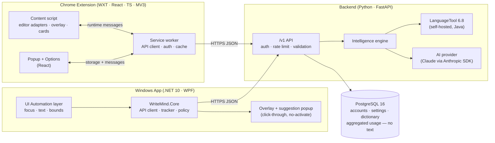

# WriteMind AI — System Architecture

> **Detect Instantly. Suggest Intelligently. Let Users Decide.**

WriteMind AI is a writing assistant delivered through two clients — a Chrome
extension and a Windows desktop app — backed by one shared intelligence engine.
This document is the reference design: components, data flow, contracts,
schema, endpoints, milestones and setup.

---

## 1. Non-negotiable product rules

| # | Rule | How the architecture enforces it |
|---|------|----------------------------------|
| R1 | **Never modify the user's text without explicit approval.** | Clients only *read* text and draw overlays. The only code path that writes into a field is `applySuggestion()` / `ApplyAsync()`, which is reachable exclusively from an Accept click/keypress on a specific suggestion card. There is no "auto-correct", no "accept all on type", and no background writer. Every apply first re-verifies that the original span is still present; otherwise it refuses. |
| R2 | **No hidden keystroke logging.** | Neither client installs keyboard hooks. The extension reads the focused field's current value on `input` events; the desktop app reads the focused control's text through UI Automation when it raises a text-changed/focus event. Keys are never recorded. |
| R3 | **Exclude passwords and sensitive inputs.** | A single policy (`isSensitiveField` in TS, `SensitiveFieldPolicy` in C#) runs before any text is read: password fields, `autocomplete` credential/payment/OTP hints, names like `cvv|ssn|iban|otp|token|secret`, `data-writemind="off"`, Grammarly's `data-gramm="false"`, UIA `IsPassword`, and a blocklist of password-manager/terminal processes. |
| R4 | **Don't store users' text.** | The backend has no table that holds user prose. Text lives only in request memory and an optional, short-TTL, in-process result cache keyed by a SHA-256 hash. Logs record lengths and timings, never bodies. Before text reaches the AI provider, emails, phone numbers, URLs, card/IBAN numbers are replaced by placeholders and restored afterwards. |
| R5 | **Preserve meaning.** | Every AI correction and rewrite passes through `MeaningGuard`: numbers, negations, named entities, URLs/e-mails/mentions and placeholders must survive; edit distance must stay within bounds. Edits that fail are dropped (corrections) or flagged (rewrites). |

---

## 2. High-level architecture



### 2.1 Request lifecycle (typing → suggestion → user decision)

1. **Detect focus** — client finds the focused editable element/control, runs the
   sensitive-field policy, selects an adapter (textarea, contenteditable, Gmail,
   WhatsApp, LinkedIn / Word, Notepad, Outlook, WhatsApp Desktop, generic UIA).
2. **Read & debounce** — on change, the adapter produces a *flat text* plus a
   mapping back to DOM nodes / UIA ranges. Two timers run:
   * **fast** (≈300 ms idle) → `POST /v1/check {mode:"fast"}` — LanguageTool +
     WriteMind rules, typically 40–200 ms server time.
   * **full** (≈1.2 s idle) → `POST /v1/check {mode:"full"}` — adds AI contextual
     corrections for changed paragraphs.
3. **Engine** — splits text into paragraphs, serves unchanged paragraphs from
   the hash cache, checks the rest concurrently, filters protected spans
   (URLs, e-mails, @mentions, #tags, `code`) and the personal dictionary, maps
   categories, merges/deduplicates LanguageTool + AI results, and returns
   suggestions with **UTF-16 offsets**.
4. **Reconcile** — the client drops stale responses (text hash mismatch), or
   rebases offsets for edits made outside a suggestion's span while the request
   was in flight; suggestions whose span was edited are discarded.
5. **Render** — underlines are drawn in an overlay layer (shadow DOM / click-through
   window). The user's DOM/document is never mutated for highlighting.
6. **Decide** — hover/click shows a card: *Accept* (choose a replacement),
   *Ignore* (this occurrence), *Ignore rule*, *Add to dictionary*. Only *Accept*
   writes, through the editor's native input pipeline so undo history and
   framework state (React, Lexical, Quill, Word) stay consistent.
7. **Feedback** — the client reports `{rule_id, category, source, action}` (no
   text) so aggregate quality metrics can tune rule profiles.

### 2.2 Built-in checker (no server required)

Both clients embed a built-in checker so they work immediately after install, offline, with no account:
Hunspell spelling (`shared/dictionaries`, en-US/en-GB) plus 45 grammar, punctuation and style rules defined once in
[`shared/offline/rules.json`](../shared/offline/rules.json). The extension (TypeScript, `extension/src/offline`) and the
Windows app (C#, `desktop/src/WriteMind.Core/Offline`) both interpret that file; `shared/fixtures/offline-parity.json`
proves they return identical suggestions. Each client tries the server first and falls back to the built-in checker
(retrying the server every 30 s), so the same UI and contract work in both modes.

### 2.3 Why offsets are UTF-16

JavaScript strings, .NET strings and LanguageTool (Java) all index text in
UTF-16 code units. Python indexes code points. The backend therefore converts
every internally-computed position to UTF-16 at the API boundary
(`engine/offsets.py`), and the API contract states *all offsets and lengths are
UTF-16 code units*. Emoji and other astral characters are covered by tests on
all three stacks.

---

## 3. Repository layout

```
.
├── README.md                     product overview + quick start
├── docs/
│   ├── ARCHITECTURE.md           this document
│   ├── API.md                    endpoint reference with examples
│   ├── PRIVACY.md                data handling & threat model
│   └── SETUP.md                  developer setup, all platforms
├── shared/
│   ├── openapi.json              generated from FastAPI (single source of truth)
│   └── fixtures/                 contract fixtures consumed by all three test suites
├── backend/                      Python 3.12+ · FastAPI · SQLAlchemy 2 (async) · Alembic
│   ├── pyproject.toml
│   ├── alembic.ini · alembic/versions/
│   ├── app/
│   │   ├── main.py               app factory, middleware, routers
│   │   ├── core/                 config, security (argon2/JWT), logging, rate limiting, errors
│   │   ├── db/                   engine/session, declarative base
│   │   ├── models/               ORM: user, refresh_token, device, settings, dictionary, …
│   │   ├── schemas/              Pydantic request/response models (API contract)
│   │   ├── api/v1/               routers: auth, check, rewrite, settings, dictionary, feedback, usage, meta
│   │   ├── services/             account, usage aggregation, data export/deletion
│   │   └── engine/               the intelligence engine (see §4)
│   └── tests/                    pytest (unit + API + real LanguageTool integration)
├── extension/                    WXT · React 19 · TypeScript · MV3
│   ├── wxt.config.ts
│   ├── entrypoints/
│   │   ├── background.ts         service worker: API, auth refresh, in-flight cancellation, sync, badge
│   │   ├── content/index.tsx     content script: mounts the shadow-DOM UI and the Assistant controller
│   │   ├── popup/                toolbar popup (React)
│   │   └── options/              settings, account, dictionary, rules, sites (React)
│   ├── src/
│   │   ├── shared/               API types, message protocol, API client, settings storage, site profiles
│   │   ├── core/                 suggestion store, offset rebasing, span validation, debounce scheduler
│   │   ├── editors/              sensitive-field policy, text maps, textarea mirror, adapters + apply pipeline
│   │   ├── content/              Assistant controller (sessions, geometry, hit-testing, actions)
│   │   └── ui/                   React components (underlines, badge, card, panel, rewrite) + styles
│   ├── tests/                    vitest (jsdom) unit + contract tests
│   └── e2e/                      Playwright: real Chromium + built extension + live API
├── desktop/                      .NET 10
│   ├── WriteMind.slnx
│   ├── src/
│   │   ├── WriteMind.Core/       net10.0 — API client, models, tracker, policy, settings (cross-platform, unit-tested)
│   │   └── WriteMind.Desktop/    net10.0-windows WPF — Automation/ (UIA), Overlay/, Controls/, Views/, Services/
│   └── tests/WriteMind.Core.Tests/  xUnit
├── infra/
│   ├── docker-compose.yml        postgres + languagetool + backend
│   ├── languagetool/             Maven descriptor (LT from Maven Central) + Dockerfile
│   └── backend.Dockerfile
├── scripts/                      dev helpers (fetch LT, run stack, export OpenAPI)
└── .github/workflows/ci.yml      backend · extension · desktop (windows-latest)
```

---

## 4. Backend design

### 4.1 Layers

| Layer | Responsibility |
|-------|----------------|
| `api/v1/*` | HTTP surface, request validation (Pydantic v2), auth dependency, rate-limit dependency. Thin. |
| `services/*` | Account lifecycle, settings/dictionary CRUD, usage counters, export/delete. |
| `engine/*` | Stateless text intelligence. No DB access except via injected `UserContext` (dictionary, disabled rules, preferences). |
| `models/*`, `db/*` | SQLAlchemy 2.0 async ORM over asyncpg; Alembic migrations. |
| `core/*` | Settings (pydantic-settings, env-driven), argon2id hashing, JWT, structured logging, error envelope, security headers, rate limiter. |

### 4.2 Intelligence engine (`app/engine`)

```
CheckRequest
   │
   ▼
pipeline.check() ──► segment.py   split into paragraphs (keeps UTF-16 base offsets)
   │                 cache.py     per-paragraph LRU (key = sha256(text|lang|style|mode|profile)), TTL, in-memory only
   │
   ├─► languagetool.py   async HTTP client → LT /v2/check (pooled, timeout, circuit breaker)
   │        └─ profiles.py   style → LT options (level=picky for formal/professional,
   │                          disabled rules for casual chat), category mapping
   ├─► rules.py          WriteMind rules LT lacks: formal-register contractions,
   │                      informal vocabulary, lowercase "i", doubled punctuation…
   ├─► ai/               (mode=full, only if enabled and configured)
   │      redaction.py   mask e-mail/phone/URL/card/IBAN → ⟦E1⟧ placeholders
   │      provider.py    AIProvider protocol · AnthropicProvider · NullProvider
   │      corrections.py ask for corrected text + edit reasons (JSON schema output);
   │                     derive edits by token-level diff (robust offsets);
   │                     attach reasons; restore placeholders
   │      meaning_guard.py  reject edits that alter numbers, negation, entities,
   │                        protected tokens, or exceed edit-distance budget
   ├─► protect.py        drop suggestions inside URLs, e-mails, @mentions, #tags, code
   ├─► merge.py          dedupe overlaps; LT ∩ AI agreement boosts confidence;
   │                      AI grammar edit supersedes overlapping LT grammar hits;
   │                      spelling stays dictionary-driven
   ├─► filters           personal dictionary, user-disabled rules, category toggles
   └─► offsets.py        code points ⇄ UTF-16, final contract conversion
   ▼
CheckResponse (suggestions sorted by offset, stable ids + fingerprints)
```

**Rewrite engine** (`engine/rewrite.py`): `POST /v1/rewrite` produces 1–3
alternatives in a target style (professional, formal, casual, friendly,
concise). With an AI provider it requests JSON alternatives; every alternative
is passed through `MeaningGuard` and placeholders are restored. Without AI (or
on AI failure) a deterministic style transformer runs: contraction
expansion/contraction, informal→formal lexicon, filler removal, capitalisation
and terminal punctuation, combined with LanguageTool's top fixes — so the
feature degrades gracefully instead of disappearing. Alternatives are always
*proposals*; the client inserts one only on click.

**Latency strategy**
* paragraph-level caching → re-checks after an edit only touch the edited paragraph;
* concurrent paragraph checks against a pooled LT client;
* fast/full split so LanguageTool results never wait on the LLM;
* AI calls bounded by a hard timeout (default 6 s) and skipped for paragraphs
  with no change; failures degrade to LT-only with `engine.ai = "error"`;
* LT runs in-cluster (no third-party hop) with a warmed JVM.

**AI provider** — `AnthropicProvider` uses the official `anthropic` SDK
(`AsyncAnthropic`), model from `WRITEMIND_AI_MODEL` (default `claude-opus-5-5`,
`effort: low` for latency), structured JSON output via `output_config.format`,
a stable system prompt marked for prompt caching, server-side refusal
fallback enabled, and typed error handling (rate-limit / 5xx / connection →
graceful degradation). The provider interface keeps the engine testable with a
deterministic fake and lets operators swap models without code changes.

### 4.3 Cross-cutting

* **Auth** (server only; the clients currently have no sign-in and store preferences locally): e-mail + password (argon2id). Access JWT (HS256, 15 min) + opaque
  refresh token (256-bit, stored only as SHA-256 hash) with rotation and reuse
  detection (reuse revokes the whole token family). Guests may use `/check` and
  `/rewrite` under a stricter IP-keyed rate limit; signing in adds sync and
  higher limits.
* **Rate limiting**: token bucket per user/IP and per route class (`check`,
  `rewrite`, `auth`). In-process by default; interface allows Redis.
* **Limits**: text ≤ 20 000 chars per check, ≤ 2 000 per rewrite (configurable); 413 above.
* **Errors**: uniform envelope `{"error": {"code", "message", "request_id"}}`.
* **Logging**: JSON lines — method, route, status, latency, `text_len`,
  request id. Request/response bodies are never logged.
* **Security headers**: `X-Content-Type-Options`, `Referrer-Policy`,
  `Cache-Control: no-store` on text endpoints, strict CORS allow-list
  (extension origins + configured web origins).

---

## 5. Database schema (PostgreSQL)

No column stores user-authored prose. Dictionary words are user-curated
vocabulary, explicitly added by the user.

```sql
users (
  id              uuid PK,
  email           varchar(320) UNIQUE NOT NULL,  -- stored trimmed + lower-cased
  password_hash   text NOT NULL,            -- argon2id
  display_name    text,
  plan            text NOT NULL DEFAULT 'free',   -- free | premium
  is_active       boolean NOT NULL DEFAULT true,
  created_at, updated_at timestamptz
)

refresh_tokens (
  id              uuid PK,
  user_id         uuid FK → users ON DELETE CASCADE,
  family_id       uuid NOT NULL,            -- rotation chain
  token_hash      char(64) UNIQUE NOT NULL, -- sha256
  client          text,                     -- chrome-extension | windows-desktop
  created_at, expires_at, revoked_at, replaced_by uuid
)

user_settings (
  user_id         uuid PK FK → users ON DELETE CASCADE,
  language        text NOT NULL DEFAULT 'en-US',
  default_style   text NOT NULL DEFAULT 'neutral',
  ai_enabled      boolean NOT NULL DEFAULT true,
  enabled_categories text[] NOT NULL,       -- grammar, spelling, punctuation, style, clarity
  disabled_rules  text[] NOT NULL DEFAULT '{}',
  disabled_sites  text[] NOT NULL DEFAULT '{}',   -- extension
  disabled_apps   text[] NOT NULL DEFAULT '{}',   -- desktop (process names)
  updated_at timestamptz
)

dictionary_entries (
  id              uuid PK,
  user_id         uuid FK → users ON DELETE CASCADE,
  word            text NOT NULL,
  created_at timestamptz,
  UNIQUE (user_id, lower(word))
)

usage_daily (                               -- aggregated counters only
  user_id         uuid FK → users ON DELETE CASCADE,
  day             date,
  checks          int, characters int, suggestions_shown int,
  accepted        int, ignored int, rewrites int,
  PRIMARY KEY (user_id, day)
)

suggestion_feedback (                       -- quality signal, no text
  id              bigserial PK,
  user_id         uuid NULL FK → users ON DELETE SET NULL,
  rule_id         text NOT NULL,
  category        text NOT NULL,
  source          text NOT NULL,            -- languagetool | ai | writemind
  action          text NOT NULL,            -- accepted | ignored | rule_disabled | added_to_dictionary
  client          text NOT NULL,
  created_at timestamptz
)
```

Indexes: `refresh_tokens(user_id)`, `refresh_tokens(family_id)`,
`suggestion_feedback(rule_id, action)`, `suggestion_feedback(created_at)`.

---

## 6. API endpoints (`/v1`)

| Method | Path | Auth | Purpose |
|--------|------|------|---------|
| GET | `/health` | – | Liveness |
| GET | `/health/ready` | – | DB + LanguageTool readiness |
| GET | `/v1/meta` | – | Supported languages, styles, categories, limits, AI availability |
| POST | `/v1/auth/register` | – | Create account → token pair |
| POST | `/v1/auth/login` | – | Password login → token pair |
| POST | `/v1/auth/refresh` | – | Rotate refresh token → new pair |
| POST | `/v1/auth/logout` | refresh | Revoke token family |
| GET | `/v1/me` | bearer | Profile + plan |
| DELETE | `/v1/me` | bearer | Delete account and all data |
| GET | `/v1/me/export` | bearer | Export settings, dictionary, usage (JSON) |
| POST | `/v1/check` | optional | Grammar/spelling/punctuation/style check (`mode: fast|full`) |
| POST | `/v1/rewrite` | optional | 1–3 alternative phrasings in a target style |
| GET / PUT | `/v1/settings` | bearer | Synced preferences |
| GET / POST | `/v1/dictionary` | bearer | List / add words |
| DELETE | `/v1/dictionary/{word}` | bearer | Remove word |
| POST | `/v1/feedback` | optional | Accept/ignore signal (no text) |
| GET | `/v1/usage/summary?days=7` | bearer | Aggregated stats for popup/dashboard |

Full request/response examples: [`docs/API.md`](API.md). Machine-readable:
[`shared/openapi.json`](../shared/openapi.json).

---

## 7. Chrome extension design

**Stack**: WXT (MV3 build), React 18, TypeScript (strict), vitest + jsdom,
Playwright for e2e with the real unpacked extension.

**Entrypoints**
* `background.ts` — sole network client. Holds tokens in `chrome.storage.local`,
  refreshes them, aborts superseded requests per field (`AbortController` keyed
  by tab+frame+field), short-lived response cache, badge text.
* `content/` — runs in all frames (`all_frames`, `match_about_blank`) on
  `<all_urls>`, idle until an editable gains focus.
* `popup/` — on/off for current site, connection & account state, today's stats.
* `options/` — account, backend URL, language, default style, categories,
  personal dictionary, disabled sites, AI toggle, privacy notes.

**Content-script modules**
| Module | Role |
|--------|------|
| `editors/sensitive.ts` | R3 policy (password, credential/payment/OTP autocomplete, name/id patterns, opt-out attributes, `inputmode=numeric` short fields). |
| `editors/textMap.ts` | Walks a contenteditable root into flat text with block-level `\n` and a segment table → `offset ↔ (node, nodeOffset)` both ways. Skips adapter-excluded subtrees (Gmail quoted text, signatures). |
| `editors/mirror.ts` | Textarea/input geometry via mirror element with copied computed styles → client rects for any range. |
| `editors/adapters.ts` | `TextareaAdapter`, `ContentEditableAdapter` + site profiles (Gmail, WhatsApp Web/Lexical, LinkedIn/Quill, generic). Uniform interface: `getText()`, `getRects(start,end)`, `apply(start,end,expected,replacement)`. |
| `editors/adapters.ts` (`apply`) | Writes **only** on Accept: select range → `execCommand('insertText')` (keeps undo, fires `beforeinput`/`input` for React/Lexical/Quill) → verify → fallback `InputEvent` / synthetic paste → verify → otherwise copy to clipboard and tell the user. Refuses if the span no longer equals `expected`. |
| `core/store.ts`, `core/rebase.ts` | Suggestion state per field: merge fast/full results, rebase offsets on edits, ignored fingerprints, boundary-aware span validation. |
| `content/assistant.ts` | Field sessions, geometry and clipping, hit-testing, all user actions; renders via rAF on scroll/resize/ResizeObserver/MutationObserver. |
| `ui/*` | React in shadow DOM: issue badge (count, colour by severity), suggestion card (Accept / Ignore / Ignore rule / Add to dictionary), assistant panel (all issues + **Rewrite** tab with Professional / Casual / Formal / Friendly / Concise). |

**Permissions**: `storage`, `activeTab`-free design (content script declared
statically), host access `<all_urls>` for editors + backend. No `scripting`,
`tabs` history access or remote code.

---

## 8. Windows application design

**Stack**: .NET 10, WPF, `System.Windows.Automation` (UIA), Win32 interop
(`SetWinEventHook`, `SendInput`, window styles), WinForms `NotifyIcon` for the tray.

**Projects**
* `WriteMind.Core` (net10.0, cross-platform, unit-tested on Linux/Windows):
  `WriteMindApiClient` (typed HttpClient, retries, token refresh),
  contract models (System.Text.Json source-gen), `SuggestionTracker`
  (stale detection + offset rebasing), `Debouncer`, `SensitiveFieldPolicy`,
  `AppCatalog` (supported/blocked processes), `PersonalDictionary`,
  `SettingsStore` (JSON + pluggable secret protector), `TextSpanLocator`
  (find the expected span near an offset when the host app's text shifts).
* `WriteMind.Desktop` (net10.0-windows WPF):
  * `Automation/FocusMonitor` — UIA focus-changed events; `Services/AssistantController`
    filters each focused element via `AppCatalog` + `SensitiveFieldPolicy`
    (`IsPassword`, control type, names) *before* reading any text, then polls the
    focused control's text (≈400 ms) to detect edits — never keystrokes.
  * `Automation/TextControlAccessor` — reads text via `TextPattern`
    (Word, Outlook, new Notepad, WhatsApp/WebView2) or `ValuePattern`
    (classic Edit), large documents use the *visible* range only; maps
    suggestion spans to `TextPatternRange`s and screen rectangles.
  * `Automation/TextApplier` — on Accept only: select the target range via UIA,
    verify selected text equals the expected original, type the replacement with
    `SendInput(KEYEVENTF_UNICODE)` (undo-friendly, formatting-preserving), re-read
    and verify. No clipboard clobbering, no keyboard hook.
  * `Overlay/UnderlineOverlayWindow` — transparent, topmost, click-through
    (`WS_EX_TRANSPARENT|WS_EX_LAYERED|WS_EX_NOACTIVATE|WS_EX_TOOLWINDOW`),
    DPI-aware squiggles.
  * `Overlay/SuggestionPopup` — non-activating window so the host app keeps
    focus and caret; Accept / Ignore / Add to dictionary / Turn off rule.
  * `Overlay/AssistantWindow` (hosting `Controls/AssistantPanel`) — all issues +
    Rewrite (style chips) for the current field, also non-activating;
    `Views/EditorWindow` — built-in editor (TextBox + squiggle adorner) for apps
    whose UIA support is too weak; `Views/SettingsWindow`.
  * `Services/HotkeyService` — Ctrl+Alt+W via `RegisterHotKey` (not a hook).
  * Tray: enable/disable, pause 30 min, per-app toggle, sign-in, quit.

**App compatibility matrix** (initial)
| App | Process | Text access | Apply |
|-----|---------|-------------|-------|
| Microsoft Word | `WINWORD.EXE` | TextPattern (visible range) | UIA select + SendInput |
| Outlook classic / new | `OUTLOOK.EXE`, `olk.exe` | TextPattern | UIA select + SendInput |
| Notepad (Win10/11) | `notepad.exe` | ValuePattern / TextPattern | UIA select + SendInput |
| WhatsApp Desktop | `WhatsApp.exe`, `WhatsApp.Root.exe` | TextPattern (WebView2) | UIA select + SendInput |
| Generic Win32 Edit/RichEdit | any (opt-in) | ValuePattern / TextPattern | UIA select + SendInput |
| Browsers | `chrome.exe`, `msedge.exe` | skipped — extension owns these | – |
| Password managers, terminals, IDEs | blocklist | never read | – |

---

## 9. Development milestones

| Milestone | Scope | Status / evidence |
|-----------|-------|-------------------|
| **M0 Foundations** | Repo layout, docs, LanguageTool via Maven, scripts | ✅ LanguageTool 6.8 answers `/v2/check` locally |
| **M1 Backend platform** | Config, models, Alembic, auth (argon2/JWT/refresh rotation), settings, dictionary, feedback, usage, export/delete, rate limits, logging | ✅ pytest green against PostgreSQL; migration tested up/down/up |
| **M2 Intelligence engine** | LT client, profiles, rules, offsets, segmentation + cache, protection, merge, AI provider + diff-to-edits + meaning guard + redaction, rewrite with offline fallback | ✅ accuracy fixture 42/42 detected, 0/23 false positives; HTTP p50 52 ms |
| **M3 Chrome extension** | Sensitive policy, text maps, adapters, apply pipeline, store/rebase, overlay, React UI, background, popup, options | ✅ 59 vitest + 7 Playwright e2e in real Chromium against the live API |
| **M4 Windows app** | Core library + tests, UIA layer, overlay, popup, assistant, editor, settings, tray, hotkey | ✅ 51 xUnit tests (incl. live API); WPF builds warning-free; single-file publish |
| **M5 Hardening & release** | Security pass, CI, packaging, docs | ✅ CI (backend, extension + e2e, Windows); extension zip; `WriteMind.exe`; docs |

**Next steps** toward a commercial launch: Chrome Web Store listing and a pinned extension ID; Windows
code signing + MSIX/installer; interactive QA of the UIA layer across Word/Outlook/Notepad/WhatsApp
builds; a shared rate limiter for multi-replica deployments; billing for premium plans; more languages
in WriteMind rules and the offline rewrite engine.

## 10. Dependencies & setup

| Component | Requirements |
|-----------|--------------|
| Backend | Python ≥ 3.12, PostgreSQL ≥ 15, Java ≥ 17 (LanguageTool), optional `ANTHROPIC_API_KEY` |
| Extension | Node ≥ 20, npm; Chrome ≥ 120 |
| Desktop | .NET SDK 10, Windows 10 1809+ / 11 to run (builds on any OS with `EnableWindowsTargeting`) |

Key packages — backend: `fastapi`, `uvicorn[standard]`, `pydantic-settings`,
`sqlalchemy[asyncio]`, `asyncpg`, `alembic`, `httpx`, `argon2-cffi`, `pyjwt`,
`anthropic`; tests: `pytest`, `pytest-asyncio`. Extension: `wxt`,
`@wxt-dev/module-react`, `react`, `react-dom`, `typescript`, `vitest`, `jsdom`,
`@playwright/test`. Desktop: BCL only for Core; WPF + WinForms (tray) for the app;
`xunit` for tests.

Step-by-step commands live in [`docs/SETUP.md`](SETUP.md).
